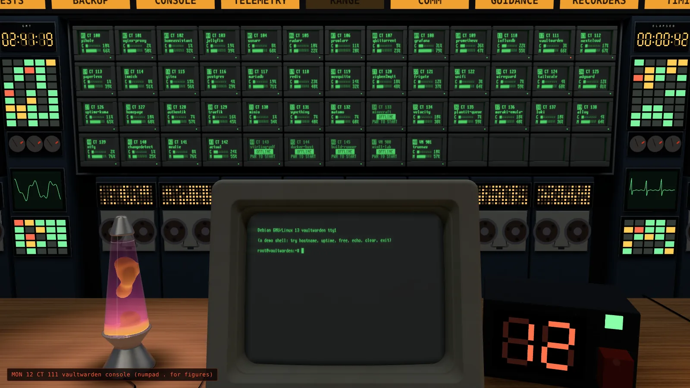

# proxmox-crt

A security office for your Proxmox host: a wall of CRT monitors, one per VM or
container, cabinets of blinking lamps and turning tape reels under it, and
on the desk a terminal for whichever guest you switch to and a monitor for
each node.



It grows out of [dubsector/terminal](https://github.com/dubsector/terminal),
whose tube shader, character ROM and way of drawing text as a video signal it
reuses.

## What it does

- **A monitor for every guest.** A wall of 13 x 4 small monitors, each with a
  guest's number, name, CPU and memory. A stopped guest shows OFFLINE, and a
  monitor switches off and warms up again as its guest stops and starts.
- **A real terminal on the desk.** Selecting a running guest puts its console
  on the desk terminal, ready to type into: what `pct console` gives for a
  container, the serial port for a VM. The last four consoles stay attached.
  Scrollback, copy and paste work as in any terminal.
- **Power.** A guarded switch starts a stopped guest and shuts down a running
  one.
- **The nodes.** A small monitor for each node above the keyboard, and
  cabinets, meters and a plot on the wall that follow the nodes' load.
- **A room to sit in.** Modelled in Blender with its light baked in: racks,
  boards, clocks, a keyboard whose keys go down, a desk lamp, a lava lamp.
- **Sign-in to match what it can do.** A password, then an authenticator
  app's code or a passkey, or single sign-on through an OpenID Connect
  provider. The API token stays in the bridge and never reaches a browser.

All of it is described in [docs/room.md](docs/room.md).

## Install

On the Proxmox host, as root:

```sh
bash -c "$(curl -fsSL https://raw.githubusercontent.com/dubsector/proxmox-crt/main/ct/proxmox-crt.sh)"
```

That makes a Debian 13 container (1 core, 512 MB, 2 GB, unprivileged) and
installs the latest [release](https://github.com/dubsector/proxmox-crt/releases)
into it. Nothing is compiled in the container. Then:

1. Give the wall an API token. On the Proxmox host:

   ```sh
   pveum user add crt@pve
   pveum role add CRTWall --privs "VM.Audit VM.Console VM.PowerMgmt Sys.Audit"
   pveum acl modify / --users crt@pve --roles CRTWall
   pveum user token add crt@pve wall --privsep 0
   ```

2. Read the setup code in the container (`pct enter <id>`):

   ```sh
   journalctl -u proxmox-crt | grep "setup code" | tail -n 1
   ```

3. Open `http://<container address>:8086`, and give the setup card the code,
   the Proxmox address, the token and a password of your choosing.

To update, run `update` in the container. It takes the latest release and
leaves the settings alone.

Installing by hand on any Debian machine, what the scripts do and how a
release is made are in [deploy/README.md](deploy/README.md). To try the room
without a Proxmox host, see [Development](#development): `?demo=1` runs a
made-up cluster in the page.

## Controls

| To | Do this |
|---|---|
| Select a guest | Type its monitor number on the numpad, press `+` or `-`, turn the dial, or click a wall monitor. |
| Type into it | Just type: every key but the numpad goes to the guest on the desk. |
| See its figures | Numpad `.` flips the desk between the console and the gauges. |
| Start or shut it down | Numpad `*` lifts the switch's cover, numpad Enter throws the switch. Numpad `/` then cuts the power instead. |
| Scroll back | Mouse wheel over the desk terminal's screen. |
| Copy and paste | Drag across the screen to copy, Ctrl+V to paste. |
| Look around | Move the pointer. A right click holds the view, a double-click goes back to the seat. |
| Close in | Mouse wheel anywhere else. Scroll Lock or the LOCK ON TARGET button holds the view on the terminal. |
| Sign-in settings | The button in the bottom left corner. |

## Security

The bridge can open consoles on your guests, so treat its address as you
would the Proxmox web interface.

- The page asks for a password, kept as an Argon2 hash, and can ask for a
  second step: an authenticator app, a passkey, or your own single sign-on.
- Wrong passwords and codes are limited for each address.
- Only whoever can read the container's log can set it up, by the setup code.
- A Proxmox host that signs its own certificate is pinned by its fingerprint.
- The service runs as its own unprivileged user under a hardened unit.
- It serves plain http. To reach it from outside your network, put it behind
  a reverse proxy that adds TLS, and set `public_url` and `trusted_proxies`.

The settings file, the second step, reverse proxies and single sign-on are
described in [docs/bridge.md](docs/bridge.md).

## Still to come

VNC screens for VMs without a serial port. Until then a VM needs `serial0`
and a getty on `ttyS0` for its console.

## Development

The page alone, with a made-up cluster that runs in the page:

```sh
npm install
npm run dev     # builds on change and serves http://localhost:8086
npm run build   # production build to dist/
npm test
```

The bridge, against a real host or the mock one that comes with it:

```sh
npm run build
cd server
cargo run --example mock_pve                 # a stand-in Proxmox on https://127.0.0.1:8006
cargo run -- --config ./config.toml --client ../dist
cargo test                                   # the bridge end to end, against the mock
```

The mock prints the token and fingerprint to give the setup card; the bridge
prints the setup code.

Query parameters:

| Parameter | Effect |
|---|---|
| `?hud=1` | Draws every frame and shows the frame rate, monitor count and draw calls. |
| `?demo=1` | The made-up cluster, even where a bridge is serving the page. |
| `?guests=N` | Size of the made-up cluster (default 48). |
| `?motion=0` | No power-on and view animations, as with the browser's reduced-motion setting. |

## Layout

| Path | What it is |
|---|---|
| `client/main.js` | Page entry: snapshots in, screens out, keys and clicks. |
| `client/scene.js` | The room: wall, desk, camera, picking, the frame loop. |
| `client/gl/face.js` | The tube face shader, in a one-set form and an instanced form. |
| `client/gl/tube.js` | The desk terminal's tube, with its phosphor-state pass. |
| `client/gl/bank.js` | Many small monitors in two draw calls, one array-texture layer each. |
| `client/gl/machines.js` | The cabinets under the wall: lamps and tape reels, two draw calls. |
| `client/gl/controls.js` | The switcher box, keypad and dial on the desk. |
| `client/gl/keyboard.js` | The terminal's keyboard, in grey-box form. |
| `client/keymap.js` | What a click on a key of the desk's keyboard sends to the console. |
| `client/gl/panels.js` | The racks beside the wall: clocks, status lamps, meters, scopes. |
| `client/gl/lavalamp.js` | The lava lamp. |
| `client/gl/props.js` | The logbook, mug, headset and desk lamp. |
| `client/gl/lamp-model.js` | The desk lamp's shape, taken from terminal's scene by `tools/extract-lamp.mjs`. |
| `client/gl/cordswitch.js` | The rocker switch in a lamp's cord. |
| `client/gl/boards.js` | The big boards beyond the monitors and the signs along the top. |
| `client/gl/power.js` | What a tube does when it is switched on and off. |
| `client/gl/textgrid.js` | A grid of characters and the video signal made from it. |
| `client/gl/font9x14.js`, `client/gl/raster.js` | The character ROM and raster geometry, from terminal. |
| `client/cards.js` | What each kind of screen says. |
| `client/select.js` | The switcher's keypad logic. |
| `client/demo.js` | The made-up cluster, with a toy shell for a console. Its snapshots use Proxmox's own field names. |
| `client/bridge.js` | The real cluster, by way of the bridge: the feed of snapshots and the console sockets. |
| `client/consoles.js` | Guests' terminals: an unseen xterm.js each, drawn onto the desk tube. |
| `client/gate.js` | The setup card, the password and the second step after it, and the provider's button. |
| `client/security.js` | The sign-in settings card and the corner button that opens it. |
| `client/passkey.js` | Passkeys in the browser: the bridge's JSON to the browser's buffers and back. |
| `test/` | Unit tests for the keypad, the cards, the demo cluster, the passkey conversions, the gate and what the desk's keyboard sends. |
| `server/src/lib.rs` | The bridge: routes, the feed, the console proxy. |
| `server/src/pve.rs` | The Proxmox API client: token, pinned certificate, terminal proxy. |
| `server/src/auth.rs`, `server/src/config.rs` | Password and sessions; the settings file. |
| `server/src/totp.rs` | Authenticator app codes, their QR code, recovery codes. |
| `server/src/second_factor.rs` | The second step of logging in by code, and the routes that set it up and remove it. |
| `server/src/passkey.rs` | The second step by passkey, and the routes that add and remove passkeys. |
| `server/src/oidc.rs` | Single sign-on: the trip to the provider and back, and who is let in. |
| `server/src/visitor.rs` | Whose address a request is counted under behind a reverse proxy: `trusted_proxies` and `X-Forwarded-For`. |
| `server/examples/mock_pve.rs` | A stand-in Proxmox host for development and tests. |
| `server/tests/bridge.rs` | The bridge end to end, against the mock. |
| `docs/` | The room and its controls, and the bridge's settings and sign-in. |
| `ct/`, `install/`, `deploy/` | The LXC scripts, the systemd unit and the install guide. |

## License

[MIT](LICENSE)
